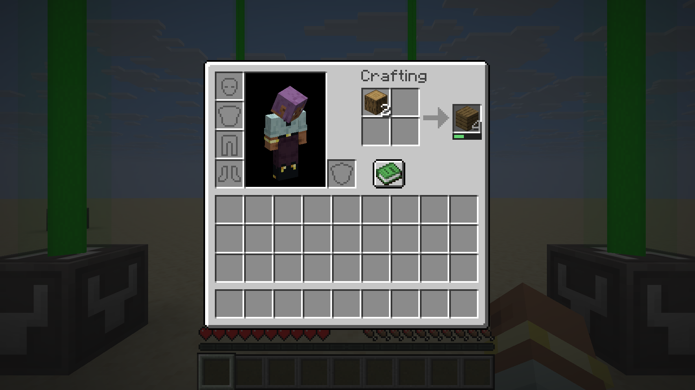

# Craft Takes Time — NeoForge 26.3

针对 Minecraft **26.3**、NeoForge **26.3.0.95**、Java **25** 的 Beta 版，版本号 `2.0.0-beta.1`。保留 CraftTakesTime 的耗时规则与音效，由服务端管理制作任务。

## 安装与操作

1. 使用 Minecraft 26.3 和 NeoForge 26.3.0.95。
2. 将 `build/libs/crafttakestime-neoforge-26.3-2.0.0-beta.1.jar` 放入实例的 `mods` 文件夹；联机时客户端和服务端均安装。
3. 在背包、工作台、铁砧、锻造台或切石机中准备配方。
4. 左键或右键点击结果：等待后获得一次完整配方的产物，放到鼠标。
5. Shift 点击结果：逐次等待，将产物放入背包；原料不足、背包满、配方改变时结束。
6. 点击其他槽位、换料、关闭菜单或断线会取消任务。等待期间不扣材料。

例如，一根原木得到四块木板，算作一次配方；Shift 制作三根原木会等待三次。普通点击一次只制作一次。右键也制作一个完整配方。

数字键交换、直接丢弃、克隆和拖拽结果槽不会立即制作。完成后可正常移动、丢弃已取得的真实物品。原版创造模式物品给予能力保持原样。



## 耗时与配置

服务端首次运行生成 `config/crafttakestime/craft_time_config.json`，修改后重启服务端（单人游戏重启客户端）。无效配置会记录错误并使用默认值，原文件保留。

```text
所需 ticks = 向上取整(
  20 × 全局倍率 × 菜单倍率 × 产物物品倍率 × 产物模组倍率
  × Σ每个非空原料槽(原料物品倍率 × 原料模组倍率)
  ÷ (1 + 0.02 × min(200, 经验等级)) ÷ crafting_speed 属性
)
```

原料按占用槽位计算，不按槽里堆叠数量计算。经验加速保持原规则，最高五倍；新属性默认值 1，与经验加成相乘。最短 1 tick；零倍率也在下一个服务端 tick 完成。

```json
{
  "enableCraftingSound": true,
  "globalCraftingTimeMultiplier": 1.0,
  "containerCraftingTimeMultipliers": {
    "minecraft:inventory": 1.0,
    "minecraft:crafting": 1.0,
    "minecraft:anvil": 1.0,
    "minecraft:smithing": 1.0,
    "minecraft:stonecutter": 1.0
  },
  "ingredientConfig": {
    "modCraftingTimeMultipliers": {"minecraft": 1.0},
    "itemCraftingTimeMultipliers": {"minecraft:stick": 1.0}
  },
  "outputConfig": {
    "modCraftingTimeMultipliers": {"minecraft": 1.0},
    "itemCraftingTimeMultipliers": {"minecraft:stick": 1.0}
  }
}
```

菜单键使用 MenuType 注册 ID；背包使用固定键 `minecraft:inventory`。例如原版工作台的键是 `minecraft:crafting`。旧配置中的 `ingredientConfig`、`outputConfig`、全局倍率及音效开关可对照复制；旧 `containers` 中按 GUI 类名、槽位和贴图坐标描述的部分采用了新结构。

有权限的玩家可使用 Minecraft 属性命令调整基础速度：

```mcfunction
/attribute @s crafttakestime:crafting_speed base set 2
```

此时在原经验加速基础上再加速两倍。命令、物品属性修饰器或其他模组可以复用原生 attribute 系统。每次制作开始时固定本次耗时，后续制作重新计算。

## 实现与扩展

- 服务端每位玩家拥有独立任务，保存菜单实例、原料完整物品组件及数量快照、产物、鼠标物品、耗时与连续制作状态。
- 使用 NeoForge 玩家 tick 事件推进，完成前再次校验菜单、原料、产物、接收空间及铁砧经验条件。
- 完成授权只存在于一次同步调用中。通过原菜单普通取出逻辑执行一次配方，保留桶返还、铁砧经验消耗、锻造消耗及原版/NeoForge 合成事件。
- 连续制作逐次执行普通取出，再将当次产物放入背包，避免原生 Shift 快移循环一次做完所有材料。
- 使用原版容器点击包发起请求，NeoForge payload 向客户端同步进度。客户端不会提交完成授权。
- 通过 `ScreenEvent.Render.Post` 在结果槽下方统一绘制进度条，读取 NeoForge 暴露的界面位置；客户端绘制无需 Mixin。
- 两个公共 Mixin 连接 `AbstractContainerMenu.clicked` 和 `Slot.mayPickup/tryRemove`，用于现成事件未提供的制作前拦截。
- `CraftingAdapter` / `CraftingAdapters.register` 提供代码扩展接口。继承 `AbstractCraftingMenu`、使用 `ResultSlot` 并走其共享点击路径的菜单具有复用基础；独立材料存储、自定义网络或覆写制作路径的工作台需要专门适配与测试。

自定义适配器在两端初始化期间注册。适配器提供输入快照、结果槽、菜单 ID、可制作条件，以及恰好执行一次配方的方法。接口假定结果槽是配方预览；已经加工好的物品仓库不应接入。

## 相关 issue 与支持范围

| 反馈 | 当前实现 |
|---|---|
| [#30 合成速度 attribute](https://github.com/jingshenSN2/CraftTakesTime/issues/30) | 添加 `crafttakestime:crafting_speed`，使用原生属性与修饰器体系。装备和其他模组可通过属性修饰器调整速度。 |
| [#27 右键 / JEI 绕过](https://github.com/jingshenSN2/CraftTakesTime/issues/27) | 制作规则放到服务端，左右键统一等待，封锁其他原版取出路径。JEI 的配方填充可保留原流程；JEI 兼容性尚未实测。 |
| [#25 第三方工作台回滚](https://github.com/jingshenSN2/CraftTakesTime/issues/25)、[#19 如何适配](https://github.com/jingshenSN2/CraftTakesTime/issues/19) | 使用菜单语义与适配接口；第三方 Crafting Station 未宣称已兼容。 |
| [#17 原料与产物倍率无效](https://github.com/jingshenSN2/CraftTakesTime/issues/17) | 按注册 ID 计算服务端倍率，使用真实物品测试原料与产物倍率。 |
| [#18 切石机](https://github.com/jingshenSN2/CraftTakesTime/issues/18) | 增加内置适配器及真实切石配方测试。 |
| [#28 背包 2×2](https://github.com/jingshenSN2/CraftTakesTime/issues/28) | 内置支持，并有测试覆盖。 |
| [#20 覆盖层方向](https://github.com/jingshenSN2/CraftTakesTime/issues/20)、[#21 分工作站音效](https://github.com/jingshenSN2/CraftTakesTime/issues/21) | 当前统一结果槽进度条与原音效，保留为后续视觉和音效扩展。 |

菜单基类负责定位制作输入和结果，原生属性承载速度加成，NeoForge 绘制事件和网络接口负责进度显示与同步。Mixin 提供制作前拦截入口。

## 构建和验证

在仓库根目录执行：

```sh
cd 26.3
./gradlew build
./gradlew runGameTestServer
./gradlew runClient
```

需要 Java 25。首次构建会下载 Gradle、NeoForge 和 Minecraft 开发资源。构建产物位于 `build/libs`。`src/testmod` 是独立开发测试模组，不包含在模组 JAR 中。

测试结果与试玩边界记录于 [VALIDATION.md](VALIDATION.md)。本版尚未覆盖任意第三方工作台、JEI / InvMove / Curios 模组组合，也未迁移旧版逐 GUI 配置的所有视觉选项。

## 来源

原作源码与音效：jingshenSN2/CraftTakesTime。NeoForge 工程基于 [NeoForgeMDKs / MDK-26.3-ModDevGradle](https://github.com/NeoForgeMDKs/MDK-26.3-ModDevGradle)。版本依据 [NeoForge 官方 Maven 元数据](https://maven.neoforged.net/releases/net/neoforged/neoforge/maven-metadata.xml)，核对日期为 2026-10-21。模板许可证保留于 `TEMPLATE_LICENSE.txt`；模组未额外授予开源许可。
